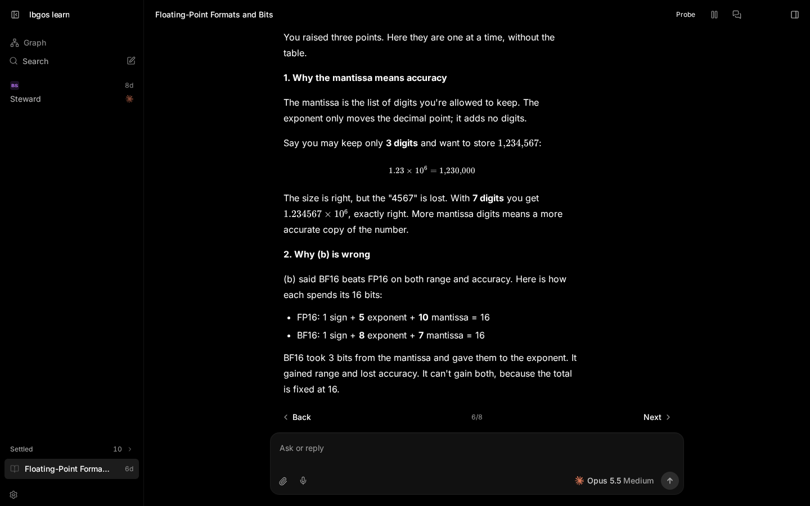
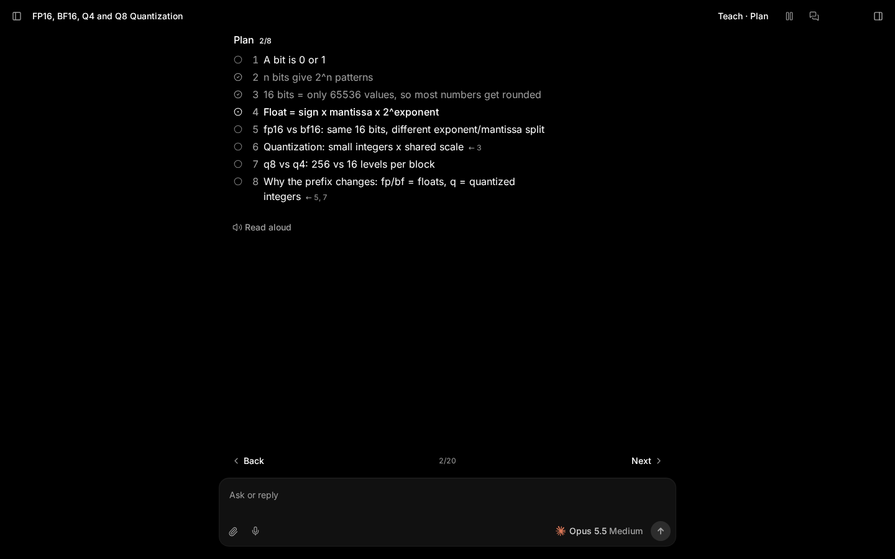
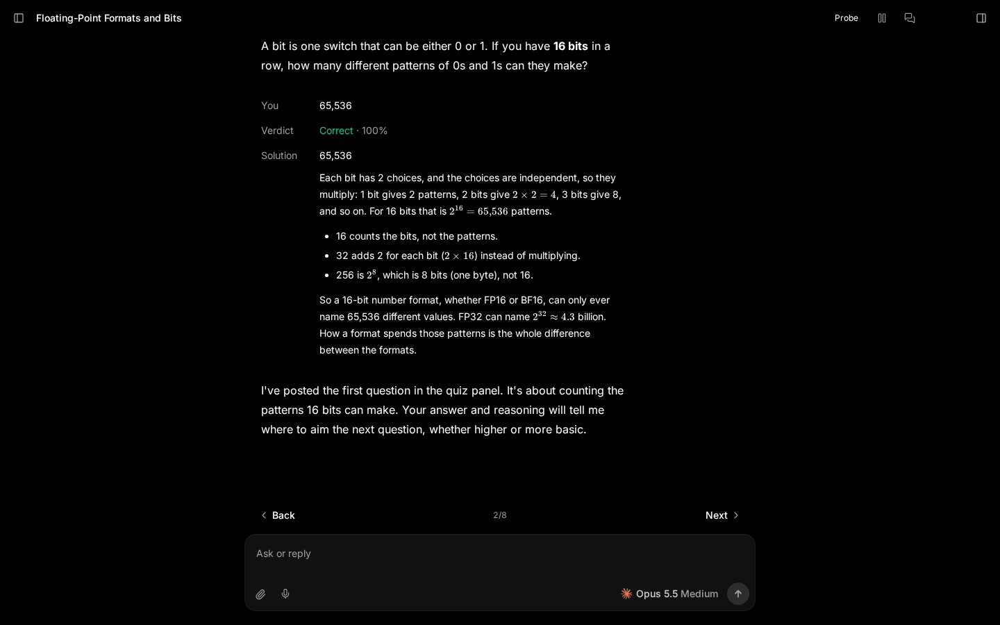
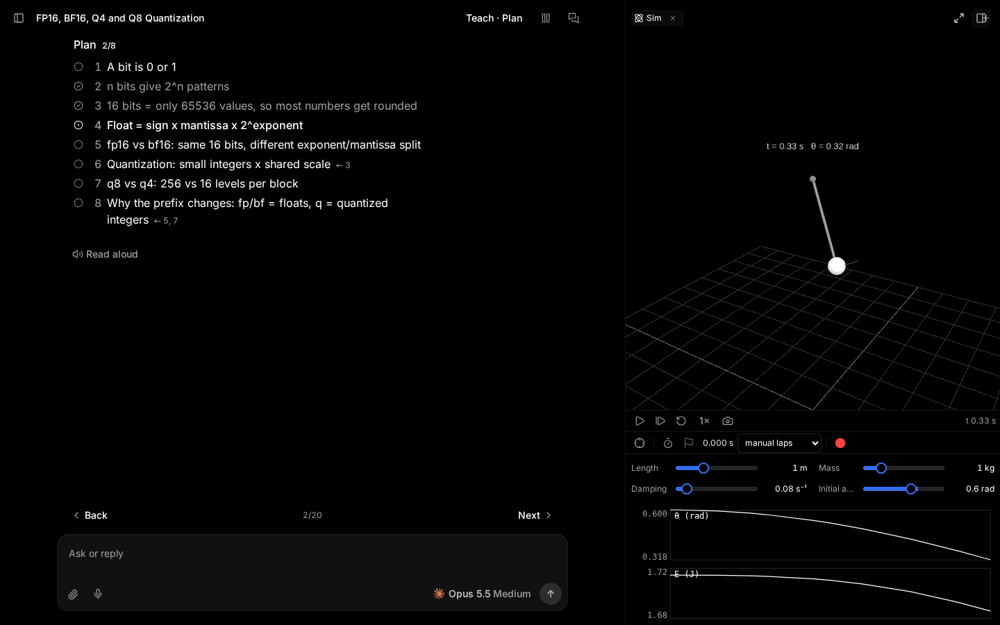
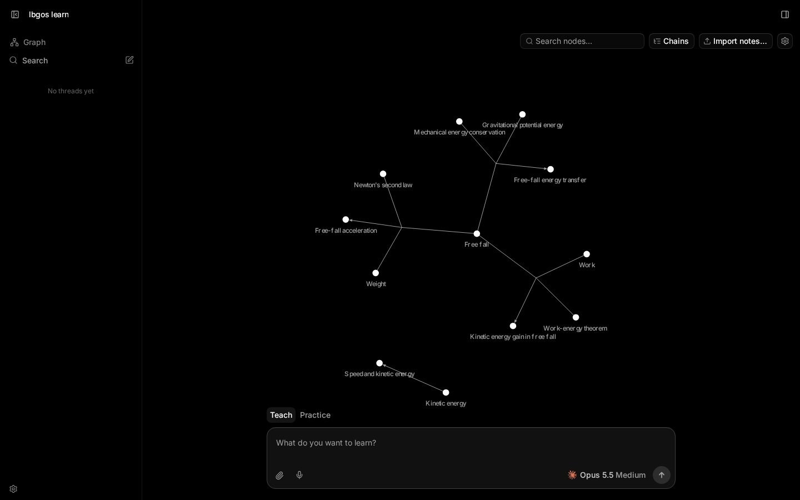
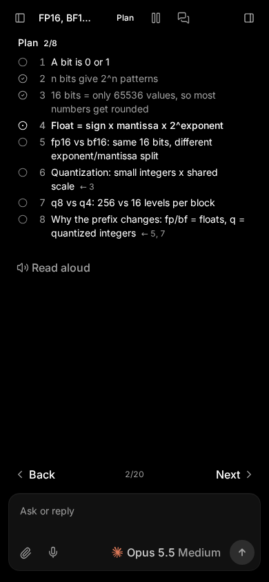
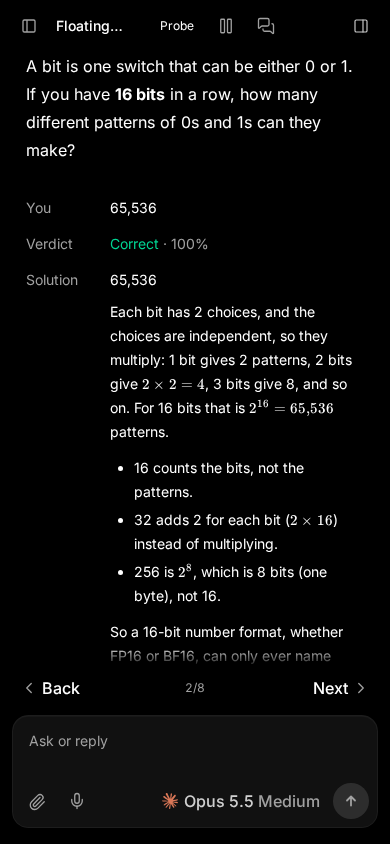

# lbgos learn

A single-user app for learning physics and math with an AI tutor. Work through a conversation, test an idea in a local simulation, and reason together on a shared whiteboard. Teaching sessions and notes feed a knowledge graph that you can return to for practice.



## Teach, then practice

Start with what you want to understand. The tutor asks opening questions and builds a plan with prerequisites. Teach sessions work through that plan; Practice sessions give you problems, hints and feedback. Read a lesson one step at a time or open the full conversation.



## Check your understanding

Answer choice and numeric quizzes, explain your reasoning, and record how confident you are. Feedback includes the answer and an explanation. Review scheduling uses your retrieval history, and confidence calibration compares your confidence with your results.



## Experiment beside the lesson

Local simulations have editable parameters, playback controls, measurements and plots. The shared whiteboard holds drawings, equations and simulation snapshots. The tutor can read and update the board while you work.



## Build a knowledge graph

The graph connects propositions and the arguments behind them, with links to their sources. Import Markdown notes or let teaching sessions contribute to it. Select concepts to start Teach or Practice sessions, and return to propositions due for review.



## Use it from your phone

The web app adapts to a narrow screen, with the same lessons, quizzes and session controls. Dictation adds speech to the composer; read-aloud plays tutor responses. Voice needs configured speech services, and remote microphone access needs HTTPS or a browser-trusted origin.

<p>
  
  
</p>

## Quick start

You need Node.js 24.13.1 or newer, pnpm 11 or newer, [Vite+](https://viteplus.dev/guide/), and an installed, authenticated agent provider. The source workspace pins Node 26.12.1 and pnpm 12.14.0 in [package.json](package.json); use those versions for a matching development toolchain.

```sh
git clone https://github.com/lbgos/learn.git
cd learn
vp i
vp run learn:dev
```

Open the web URL printed by the dev runner. The backend uses port **3873**; Vite serves the development UI on its own printed port. In Settings → Learning, choose the available providers and models for the tutor and its supporting tasks. Configure speech endpoints there if you want dictation or read-aloud.

For a built server, build the web app and server bundle, then start it:

```sh
vp run --filter t3 build
vp run learn:start
```

Open `http://localhost:3873`. The server build includes the web app.

### Data and remote browsers

The learn scripts store data in `~/.physics-code`. Conversations and SQLite state live in `~/.physics-code/userdata`; simulations, boards and learning files live in `~/.physics-code/PhysicsLab`. `PHYSICS_LAB_DIR` selects a different Lab directory. Back up the data directory to keep your work.

Local browsers authenticate automatically on a loopback-bound server. To use another browser on your network, bind the built server to a reachable interface and mint a one-time pairing link:

```sh
vp run learn:start -- --host 0.0.0.0 --no-browser
node apps/server/dist/bin.mjs pair --base-dir ~/.physics-code
```

Open the pairing link in the remote browser. Keep the link private. Settings → Connections lists paired sessions and lets you revoke them. Use an HTTPS connection for access across the internet.

## Credits

Inspired by [learnharness](https://github.com/amosblomqvist/learnharness) by Amos Blomqvist and built on [T3 Code](https://github.com/pingdotgg/t3code). This is [lbgos](https://github.com/lbgos)'s own take on the idea.

Contact: [contact@lbgos.dev](mailto:contact@lbgos.dev).

## License

The combined work is **AGPL-3.0-only** because it includes code ported from learnharness. See [LICENSE-learnharness](LICENSE-learnharness). Ported files identify their upstream source in header comments.

T3 Code's own code retains its **MIT** license. See [LICENSE](LICENSE).
